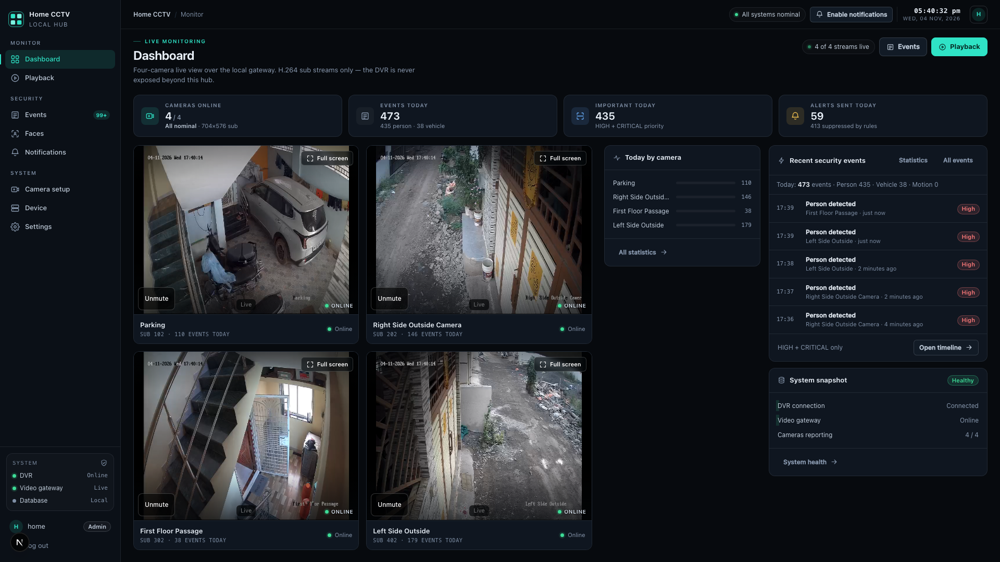
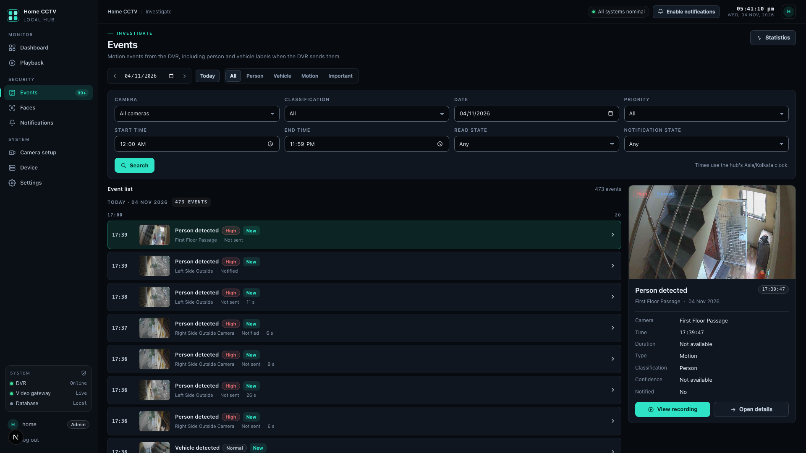
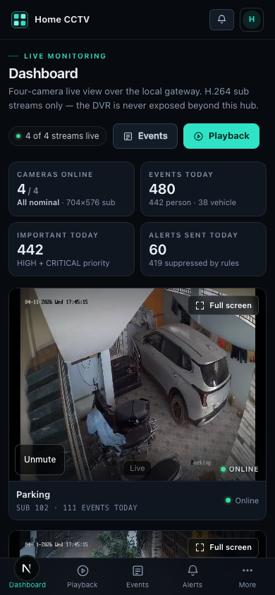

# Master UI/UX Audit — Home CCTV Hub

> **Remediation status (2026-11-04):** the approved Phase 1 + safe Phase 2 fixes have been implemented and verified — see [`REMEDIATION-REPORT.md`](REMEDIATION-REPORT.md). The findings below describe the audited baseline and remain the reference for the residual Phase 3 work.

**Audit date:** 2026-11-04 (Asia/Kolkata) · **Mode:** read-only audit (no product changes)
**Product:** Home CCTV Hub — local-first CCTV operator console for a Hikvision DVR
**Stack:** Next.js 16 (App Router) · React 19 · Tailwind CSS v4 · one global stylesheet · 17 routes
**Running build audited:** dev server at `http://localhost:3000`, "Sentinel" dark theme, live DVR + MediaMTX + SQLite data
**Conducted by:** 1 orchestrator + 4 independent critic subagents (UX, visual design, frontend architecture, design consistency), each with a fresh context and no cross-talk before reporting
**Deliverables:** this report + [`UX_REVIEW.md`](UX_REVIEW.md) · [`VISUAL_REVIEW.md`](VISUAL_REVIEW.md) · [`FRONTEND_REVIEW.md`](FRONTEND_REVIEW.md) · [`CONSISTENCY_REVIEW.md`](CONSISTENCY_REVIEW.md) + screenshot evidence in [`screenshots/`](screenshots/)

---

## 1. Executive summary

### Verdict

The hub is a **credibly designed, functionally complete operator console** with an unusually solid accessibility and contrast baseline. It is **not** in a broken state, and it does **not** need a redesign. It needs a **correctness-and-consolidation pass**: one trust defect, eight High issues concentrated in the core monitoring loop, and a long tail of design-system drift that a restyle promised but did not fully deliver.

> **Composite score: 6.3 / 10** (mean of four independent critics)

| Dimension | Score | Lead critic | Headline |
|---|---|---|---|
| UX (navigation, workflows, hierarchy, accessibility, usability) | **6.5 / 10** | Agent 1 | Strong live-video-first hierarchy; contradicted health signal, broken unread lifecycle, overlay/focus-mode focus leaks |
| Visual design (type, spacing, colour, hierarchy, components, responsive) | **6.5 / 10** | Agent 2 | Excellent contrast; 9–10 px micro-type, 12 h clock, red HIGH, pillarboxed playback, broken mobile settings tables |
| Frontend architecture (reuse, CSS, consistency, responsiveness, performance) | **6.0 / 10** | Agent 3 | No architectural rewrite needed; systematic duplication, contradictory 1024 px breakpoint, dead/inert CSS, one measured render hot spot |
| Design consistency (cross-page patterns, components, spec drift) | **6.0 / 10** | Agent 4 | One shell/primitive foundation, but 6 screens built outside the component layer; clock/date/priority semantics diverge |

### What is genuinely working (preserve)

- **Live-video-first dashboard.** The 4:3 wall is the largest, brightest element and all four cameras stay above the fold at 1920×1080; focus mode reuses the same mounted player so WebRTC never renegotiates.
- **Accessibility baseline.** Working skip link, visible 2 px focus rings, exactly one `h1` on every route, zero unnamed controls and zero unlabelled inputs across 15 runtime route sweeps, `aria-current`/`aria-pressed`/`aria-expanded`, `role="alert"` errors, `role="status"` saves, reduced-motion support, no horizontal page overflow in any of 68 route×viewport captures.
- **Colour/contrast.** Every text token pair passes WCAG AA with margin (ink 15.82:1, ink-2 11.50:1, muted 6.34:1, faint 5.44:1, accent-ink on accent 10.43:1). Status is never colour-only. The only sub-AA text is decorative separator glyphs.
- **Honest states.** Loading skeletons, titled empty states, "Not reported"/"unknown" instead of fabricated data, plain-language microcopy, destructive-action confirmations with `role="alertdialog"`.
- **Grouped navigation, settings shell, mobile bottom bar + More sheet, and an events inspector that becomes a bottom sheet** are structurally sound and consistent.
- **Security/architecture posture** (unchanged by the restyle): browser never receives DVR credentials or RTSP URLs; server-side WHEP/HLS proxying; no new runtime dependencies; `hls.js` lazy-loaded.

### The ten things to fix first (detail in §4)

1. **Make the health signal truthful** — "All systems nominal"/"Healthy" while the system page says "Degraded" and `/api/system/health` returns `degraded` (storage 93.2 %, face worker stopped 14 d, backups stale). *(Critical)*
2. **Consolidate the Events date/filter model** — two date controls, two commit rules, and a header that can label the previous day's rows with a new date. *(High)*
3. **Make unread triage possible** — no mark-read/mark-all-read, silent auto-read on detail only, today-only badge capped at 99+. *(High)*
4. **Fix focus-mode keyboard containment** — Tab escapes the full-screen video into covered dashboard controls. *(High)*
5. **Give the three modal-looking overlays real dialog semantics** — focus transfer/trap, `aria-modal`, background inert; the mobile events inspector currently leaves 40 controls tabbable behind it. *(High)*
6. **Fix the 1024 px navigation collision** — at exactly 1024 px the desktop sidebar and the mobile bottom bar both render. *(High)*
7. **Fix settings tables on phones/tablets** — an 860 px table inside a 364 px card clips values on Object detection and System. *(High)*
8. **Unify time/date notation** — 12 h clock next to 24 h content, six date formats including raw ISO and raw seconds. *(High)*
9. **Unify priority colour semantics** — HIGH is red in lists, amber in the rule editor, and red is also failure/offline/destructive. *(High)*
10. **Lift the 9–10 px type floor and non-text contrast** toward the design system's own stated contract. *(Medium)*

### Decision requested

Per the mission, **no problem has been fixed**, no source/CSS/config/API/database file has been modified, and no dependency has been installed. The redesign phase is **awaiting your approval**. Section 11 proposes a phased remediation plan; none of it has been executed.

---

## 2. Application reconnaissance (Step 1)

### 2.1 Routes (17)

| Route | Page | Access | Shape |
|---|---|---|---|
| `/login` | Sign in | public (redirects when signed in) | split brand/marketing panel + form, native POST fallback |
| `/` | Dashboard (live view) | signed-in | 4 KPI stats, 2×2 live wall, "Today by camera", rail ("Recent security events", "System snapshot") |
| `/playback` | CCTV Playback | signed-in | date popover + filters + player + timeline + transport controls |
| `/events` | Events | signed-in | date navigator, quick filters, 8-field filter panel, grouped timeline, sticky inspector / mobile sheet |
| `/events/[id]` | Event detail | signed-in | server-rendered hero snapshot + metadata + faces + playback link; marks event read on view |
| `/events/stats` | Event statistics | signed-in | KPI strip, charts/bars, per-camera breakdown, tables |
| `/faces` | Detected Faces | signed-in | 4 KPI stats, filters, paginated face gallery |
| `/notifications` | Notification history | signed-in | 4 KPI stats, filters, decision rows, pagination |
| `/cameras` | Camera setup | signed-in | DVR/gateway strip, 2×2 channel cards with rename + static previews, stream map |
| `/device` | Device | signed-in | DVR identity `kv-grid` (read-only) |
| `/account` | Account | signed-in | password change + signed-in sessions list |
| `/settings` | Settings overview | ADMIN | health cards, masked env grid, administration links |
| `/settings/users` | Users | ADMIN | user rows, create/disable/reset/delete confirmations |
| `/settings/notifications` | Notification rules | ADMIN | rules list, retention, rule editor, Telegram status |
| `/settings/detection` | Object detection | ADMIN | worker status, thresholds, per-camera overrides, sticky save bar |
| `/settings/audit-log` | Audit log | ADMIN | filter panel, audit rows, pagination |
| `/settings/system` | System | ADMIN | health cards, MediaMTX paths table, active sessions, face detection |

### 2.2 Shells, layouts and navigation

- **Root layout** (`src/app/layout.tsx`): dark body, metadata template, `lang="en"`, `force-dynamic`.
- **Hub layout** (`src/app/(hub)/layout.tsx`): server-side auth gate (`getConfig()` + `currentSession()`), renders `AppShell`.
- **Settings layout** (`src/app/(hub)/settings/layout.tsx`): ADMIN guard + two-pane `.settings-shell` with sticky `SettingsNav` (200 px) and "Back to dashboard".
- **App shell** (`src/components/layout/AppShell.tsx`): sticky 232 px sidebar (hidden ≤1024 px), 56 px app bar (breadcrumb, health pill, notifications control, IST clock, avatar), scrollable `<main>`, 5-item mobile bottom bar + More sheet, global SSE event notifier, camera-focus mode provider.
- **Navigation taxonomy:** sidebar groups **Monitor** (Dashboard, Playback) / **Security** (Events, Faces, Notifications) / **System** (Camera setup, Device, Settings); app-bar breadcrumb sections Monitor/Investigate/Configure/Account/Administration; page eyebrows are a third vocabulary (see M-18).

### 2.3 Shared UI components

`Icon` (46 inline SVGs), `Mark`, `PageHeader` (15/16 hub routes), `PageIntro` (playback only), `StatusLamp`, `EmptyState`/`ErrorBanner`/`SkeletonRows`/`MessagePanel`, `PriorityBadge`, `CameraTile`/`LivePlayer`, `FaceCard`, playback components, `SettingsNav`, `NotificationPermissionButton`, plus hooks (`usePoll`, `useCameraNames`, `useElementWidth`, `useRecordingDates`, `useCameraFocus`, `useEscapeToDismiss`).

### 2.4 Responsive breakpoints (as implemented)

| Boundary | Mechanism | Effect |
|---|---|---|
| ≥1760 px | CSS `min-width` | dashboard 3rd "today by camera" column + 420 px rail |
| ≤1500 / ≤1280 px | CSS `max-width` | faces 3-up, dashboard rail collapses to 2 cards, stat row 2-up |
| 1025 px | CSS `min-width` | sidebar breakpoint for some rules / mobile nav hidden |
| **1024 px** | **contradictory** | Tailwind `lg` shows sidebar; CSS hides it at `max-width:1024` and shows mobile nav ⇒ **both navs visible at exactly 1024** (M-06) |
| ≤1024 px | CSS `max-width` | no sidebar, bottom nav, settings nav wraps to chips, single-column layouts |
| 768 px (`md:`) | Tailwind default | inner scroll region begins (`md:h-dvh`), page padding changes — **no CSS counterpart** |
| ≤720 px | CSS `max-width` | single-column live wall, stacked forms, hidden clock/status pill, 14 px page padding |
| ≤430 px | CSS `max-width` | 2-up stats, tighter face grid, full-width segmented control |

Tailwind responsive utilities are used in 11 files (35 occurrences) alongside 21 CSS media queries, so there are three breakpoint systems in play (see M-29).

### 2.5 Existing user workflows (verified read-only)

1. Sign in → dashboard (`POST /api/auth/login`, session cookie, redirect).
2. Live wall → per-camera full-screen focus → Escape/Exit (streams stay mounted).
3. Dashboard rail → event detail → "View recording" deep link into playback (`/playback?camera=…&date=…&time=…`).
4. Events: pick day, quick-filter, advanced filters, select row → inspector (desktop) or sheet (mobile).
5. Unread triage: sidebar badge → "New" chips → open detail (implicitly marks read).
6. Playback: camera/day/time filters, calendar with recording-availability dots, timeline zoom, transport, event markers, download.
7. Faces: filter by camera/date/assignment/confidence, paginated gallery → event.
8. Notifications: decision history (sent/suppressed/failed), filters, pagination.
9. Camera setup: rename channel, "Use DVR name", per-card save feedback, stream map.
10. Notification rules: enable/disable, edit rule (cameras × events, schedule, quiet hours, cooldown), retention, dry-run tester, Telegram status.
11. Object detection: enabled switch, thresholds/FPS, per-camera overrides, sticky save, worker status.
12. Users: create, role switch, reset password, sign out sessions, delete (confirm dialogs).
13. Account: change password, view/revoke sessions.
14. Admin: audit log with filters/pagination; system health including MediaMTX paths and active viewers.

### 2.6 Current functionality and constraints discovered

- **Auth/roles:** ADMIN-only `/settings/*` guarded server-side; sidebar/More filter Settings by a **client-side role fetch after hydration** (M-23). A VIEWER account exists in the Users list but no credentials were available, so viewer runtime was not exercised.
- **Media:** server-side WHEP (or HLS fallback) with all four streams proxied same-origin; playback uses the 704×576 H.264 sub-stream; no browser transcoding; DVR never exposed publicly.
- **Data:** live SQLite store (~7.8k events, 348 faces, 247 audit-login sessions — the session count is inflated by automated audit logins and is not representative).
- **Test-locked contracts** (constrain any future change): desktop-only Playwright (1920×1080) asserts nav labels, h1 names, `article` counts, event/face/notification row shapes, detection `data-testid`s, Telegram status copy; Vitest locks playback class tokens/geometry, `PageIntro compact`, login form attributes, client-boundary secrets. Two "layout invariant" Vitest files assert their own constant strings and cannot actually fail on a UI regression (M-43).
- **Environment quirk (evidence-method note):** the Next dev server treats `127.0.0.1` as a cross-origin dev resource origin, so pages opened at `127.0.0.1:3000` render server HTML but never hydrate. All evidence in this audit was therefore captured at `http://localhost:3000` after confirming hydration (`.clock__time` populated). This is a capture-environment issue, not a product UI defect.

---

## 3. Audit method, evidence and independence

### 3.1 How the audit was run

1. **Reconnaissance (orchestrator):** routes, shells, components, CSS tokens/breakpoints, workflows, API behaviour, test constraints; Playwright capture of **17 routes × 4 viewports** (1920×1080, 1440×900, 834×1112, 390×844) plus full-page variants and interaction states.
2. **Four independent critics** were spawned with fresh contexts, each owning one deliverable and one shared task — UX, visual design, frontend architecture, design consistency. They were instructed to work read-only, in parallel and **without sharing findings**; each produced its own report and score.
3. **Independent verification (orchestrator):** re-measured the highest-impact claims (breakpoint collisions at 1023/1024/1025, `.today-col` visibility, double bottom padding, detection-table clipping, save-bar collisions, system-health API state, focus order, overlay focus, contrast token maths), then consolidated.

### 3.2 Evidence inventory

| Evidence | Location | Contents |
|---|---|---|
| Viewport screenshots | [`screenshots/desktop`](screenshots/desktop) · [`laptop`](screenshots/laptop) · [`tablet`](screenshots/tablet) · [`mobile`](screenshots/mobile) | 68 PNGs = 17 routes × 4 viewports |
| Full-page screenshots | [`screenshots/full-page`](screenshots/full-page) | 68 PNGs (long-page/pagination/footer behaviour) |
| Interaction states | [`screenshots/states`](screenshots/states) | 10 PNGs: focus mode (desktop/mobile), More sheet, events list/filters/inspector, mobile detection, **1023/1024/1025 px boundary** |
| DOM/capture metrics | [`screenshots/capture-metrics.json`](screenshots/capture-metrics.json) | 68 entries: HTTP status, h1 text/size/count, overflow, font histograms, target sizes, nav/landmark counts, console/page errors |
| Before/after reference (redesign phase) | [`../design/audit/compare`](../design/audit/compare) | official desktop/mobile before-after sheets (6 screens) |
| Archived before/after sets | `../design/audit/before`, `../design/audit/after` | original UI vs redesign captures (provenance caveat in §8) |
| Sub-reports | [`UX_REVIEW.md`](UX_REVIEW.md) · [`VISUAL_REVIEW.md`](VISUAL_REVIEW.md) · [`FRONTEND_REVIEW.md`](FRONTEND_REVIEW.md) · [`CONSISTENCY_REVIEW.md`](CONSISTENCY_REVIEW.md) | 101 raw findings (21 / 26 / 29 / 25) with file:line, measurements and screenshots |

**Capture integrity:** all 68 route×viewport captures returned HTTP 200 with **zero console errors, zero page errors and zero horizontal page overflow**. Screenshots contain the Next.js development "N" indicator (bottom-left); it is a dev-tool artifact, not product UI, and was excluded from all judgements.

### 3.3 Independence and consolidation

The four critics did not read each other's reports. The orchestrator then merged **101 raw findings into 44 consolidated findings**, removing duplicates, resolving severity disagreements (§5.2) and splitting visual from functional problems (§6). Every consolidated finding retains its source IDs so any claim can be traced back to the underlying report and screenshot.

### 3.4 Limits of this audit (what was not verified)

- **No mutating flows were executed** (no saves, deletes, password changes, user creation, Telegram/test notifications, or explicit mark-read calls) — those paths were judged from source and captures.
- **One role exercised (ADMIN).** VIEWER runtime behaviour (redirects, nav gating) is code-reviewed only; no viewer credentials exist in this workspace.
- **Chromium only**, fixed viewports; no real devices, safe-area insets, 200 % zoom/reflow, text-spacing overrides, forced colours, Safari/Firefox.
- **No automated WCAG engine or screen-reader run** (`@axe-core/playwright` is not installed and dependencies were not to be added); accessibility claims are DOM/computed-style/keyboard measurements.
- **Native date/time input rendering is locale-dependent** (12 h in the capture locale); the 12 h **clock** finding is unconditional, the input half is locale-sensitive.
- **Degraded/empty states were not forced**: DVR/backend stayed healthy, and the live dataset produced no empty event/face/notification list or confirmation dialog in the captures. Empty-state and dialog visuals are reviewed from source.
- **Contrast over bright video frames, playback intrinsic video size, calendar popover styling, and long-scroll mobile composition** were not fully measurable.
- The Account sessions count (247) is inflated by automated audit logins; treat it as a stress-case, not the operator's real state.
- **No source, CSS, config, API, schema or CCTV behaviour was modified.** Verified: the only new/changed files are the four review reports and `audit/screenshots/**`; the staged UI restyle in `src/` predates this audit.

---

## 4. Consolidated findings

Severity scale used consistently by the lead: **Critical** = affirmatively wrong/misleading safety-adjacent information or task-blocking; **High** = user-visible defect, accessibility barrier or broken core workflow; **Medium** = material friction/consistency/design-system drift; **Low** = polish, hygiene, edge cases. Category: **F** functional, **V** visual, **A** accessibility, **C** consistency/design-system, **X** frontend architecture/performance.

**Distribution: 1 Critical · 8 High · 21 Medium · 14 Low = 44 consolidated findings.**

### 4.1 Critical

#### M-01 — The console's health signal contradicts the system's own health page
**Category:** F · **Severity:** Critical · **Sources:** UX-01 (unique to Agent 1; verified independently by orchestrator)
**Where:** `src/components/layout/AppShell.tsx:184-190,231` (app-bar pill) · `src/components/dashboard/DashboardView.tsx:276-279` ("Healthy"/"Degraded" chip) · `src/app/(hub)/settings/system/page.tsx:132-145,174` (health aggregation)
**Problem:** the app bar says **"All systems nominal"** and the dashboard snapshot says **"Healthy"** while Settings → System simultaneously shows **"Degraded · checked 17:42:10"**, a **"Needs attention (degraded)"** notice with three open issues (face worker stopped 14 days, no successful backup, storage almost full), and `/api/system/health` returns `status: "degraded"`. Both "green" indicators are computed only from DVR + video-gateway connectivity, so storage exhaustion (93.2 % used, 15.9 GB free of 228.3 GB) and a dead detection worker are invisible on the surface an operator glances at. In a safety-adjacent console this is affirmatively wrong information, not a cosmetic inconsistency.
**Evidence:** [`screenshots/desktop/settings-system.png`](screenshots/desktop/settings-system.png) (pill "All systems nominal" top-right + "Degraded" body) · [`screenshots/desktop/dashboard.png`](screenshots/desktop/dashboard.png) ("System snapshot: Healthy") · `/api/system/health` JSON: `status:"degraded"`, `faceDetection.worker:"stopped"`, `heartbeatAgeSeconds:1200188`, `backups.status:"stale"`, `storage.usedPercent:93.2` · `/api/dvr/status` `dvr:"connected"`.
**Recommendation:** aggregate one canonical health status server-side (DVR + gateway + storage + worker heartbeat + backup freshness) and use the same value for the app-bar pill, the dashboard snapshot and Settings → System. Never label a scoped two-service check "All systems nominal". If aggregate state is unknown or degraded, show that prominently on every screen.

### 4.2 High

#### M-02 — Events date/filter state can mislabel the data it displays
**Categories:** F, C · **Sources:** UX-02, CON-19
**Where:** `src/components/events/EventsView.tsx:67-86,102-178,272-300,339-473,481-489`
**Problem:** the page has **two date controls bound to the same state** — the day navigator (`aria-label="Selected day"`, applies instantly) and the Date field inside the Filters panel (waits for "Search"). Editing the panel date re-renders the day-group header immediately but does not refetch: runtime measurement after typing `2026-10-30` showed the header become **"30 OCT 2026 · 30 OCT 2026" with "487 EVENTS" and no `/api/events` request**, while the true 30 Oct total was 366 — the label changed, the rows did not. For non-today days the header also prints the date twice (`dayKey` is already the date). Quick filters auto-apply while the advanced panel needs a submit, so the same screen has two commit semantics.
**Evidence:** [`screenshots/desktop/events.png`](screenshots/desktop/events.png) (both date fields visible) · [`screenshots/states/events-mobile-filters.png`](screenshots/states/events-mobile-filters.png) · runtime probe: header `"30 OCT 2026 · 30 OCT 2026 … 487 EVENTS"`, `lastEventApiCall: []`; 4 Nov total ≈487–500 vs 30 Oct 366; source lines above.
**Recommendation:** keep one date control (or a read-only reflection), one commit model, and derive the visible day/count from the **applied query** (`appliedDate`, `appliedTotal`), not draft state. Fix the duplicated date string.

#### M-03 — The unread lifecycle is invisible, incomplete and unmanageable
**Categories:** F, A · **Sources:** UX-03, UX-07, CON-17
**Where:** `src/components/events/MarkReadOnView.tsx:9-17` · `src/components/events/EventsView.tsx:552,678` · `src/components/layout/AppShell.tsx:107-129,222-227,279` · API `/api/events/[id]/read`
**Problem:** there is **no mark-read or mark-all-read control anywhere**; read state changes silently as a side effect of opening `/events/[id]` (no toast, live-region announcement or undo), and clicking "View recording" from the inspector does not mark read. The sidebar badge counts **today's unread only**, caps at **99+** against 470 unread, has **no indicator at all on tablet/mobile** (the mobile nav has no badge), and the unread API requires a date (`/api/events?read=false` without `date` → 400), so an all-time unread view is impossible. An operator can never fully clear the counter or know what "read" means.
**Evidence:** [`screenshots/desktop/events.png`](screenshots/desktop/events.png) ("New" chips + 99+ badge) · [`screenshots/mobile/dashboard.png`](screenshots/mobile/dashboard.png) (Events tab has no badge) · [`screenshots/tablet/dashboard.png`](screenshots/tablet/dashboard.png) · runtime: `markReadControls: []`, no live region on `/events`; source lines above.
**Recommendation:** add explicit "Mark read"/"Mark all read" actions (list toolbar + inspector/detail), make the state visible, announce changes, allow undo, document whether viewing detail/recording marks read, and give the badge a stated scope ("Today · 470 unread"). This likely needs a small API addition for mark-all — scope it with the redesign approval.

#### M-04 — Camera focus mode leaks keyboard and screen-reader focus into hidden content
**Category:** A · **Severity:** High · **Source:** UX-04
**Where:** `src/components/dashboard/DashboardView.tsx:67-90,226-229,317-322` · `src/components/camera/CameraTile.tsx:63-77` · `AppShell.tsx:256,323,362`
**Problem:** entering focus hides header/sidebar/mobile nav, locks body scroll, focuses **Exit** and announces the mode (good), but the rest of the dashboard remains in the DOM and accessibility tree. Pressing **Tab from Exit** moves focus to "Statistics" → "All events" → recent-event rail rows — controls visually covered by the fixed full-viewport video. A screen reader still traverses the hidden page. Escape correctly exits.
**Evidence:** [`screenshots/states/dashboard-focus-desktop.png`](screenshots/states/dashboard-focus-desktop.png) · runtime tab order `Exit → Statistics → All events → rail rows`; appbar/sidebar/mobile-nav `display:none`, body overflow hidden.
**Recommendation:** make non-focused content inert/`aria-hidden` (or render only the focused tile) while focused, keep focus inside the focused tile, restore focus to the originating "Full screen" control on exit, and keep a visible Escape hint.

#### M-05 — Modal-looking overlays are not accessible dialogs
**Category:** A · **Sources:** UX-05, CON spec-drift (dialog/sheet)
**Where:** `src/components/layout/AppShell.tsx:378-410` (More sheet) · `src/components/events/EventsView.tsx:648-700` (mobile inspector) · `src/components/playback/DatePickerField.tsx:92-125` (date popover) · `globals.css:973-1003`
**Problem:** all three surfaces look modal but lack dialog behaviour. The **mobile Events inspector** has no `role="dialog"`, no `aria-modal`, focus stays on the row **behind** the backdrop, page scroll is not locked, and **40 underlay controls remain tabbable**. The **More sheet** has `role="dialog"` and a label and Escape works, but focus is not moved into it (stays on the "More" trigger), 28 underlay controls stay tabbable, there is no `aria-modal`, no `aria-controls` and no visible close affordance. The **playback date popover** likewise leaves focus on its trigger with no trap.
**Evidence:** [`screenshots/states/mobile-more-sheet.png`](screenshots/states/mobile-more-sheet.png) · [`screenshots/states/events-mobile-inspector.png`](screenshots/states/events-mobile-inspector.png) · runtime: `focusInside:false` for both sheets; 40/28 underlay tabbables.
**Recommendation:** use one accessible dialog primitive for all three: move focus in on open (close button/heading), trap Tab, `aria-modal="true"`, `inert`/`aria-hidden` the background, lock background scroll, restore focus to the trigger on close; add a visible Close to the More sheet and `aria-controls` to its trigger.

#### M-06 — At exactly 1024 px the app renders two navigation systems
**Categories:** F, V · **Sources:** FE-15 (High), VIS-11 (Medium) — verified by orchestrator
**Where:** `src/components/layout/AppShell.tsx:256` (`sidebar hidden lg:flex`) · `globals.css:672-674` (sidebar hidden ≤1024) · `globals.css:744` (mobile nav hidden ≥1025)
**Problem:** Tailwind `lg` is `min-width:1024px`, so at exactly 1024 px the sidebar is `display:flex` while the CSS also shows the mobile bottom nav (`max-width:1024px`). Measured at 1024×768: **sidebar visible AND mobile nav visible**, body scroll height 1536 px for a 768 px viewport; 1023 px and 1025 px are both correct. 1024 px is a real device width (iPad landscape, small laptops).
**Evidence:** [`screenshots/states/viewport-1024-both-navs.png`](screenshots/states/viewport-1024-both-navs.png) · boundary captures `viewport-1023.png`, `viewport-1025.png` · measured `sidebar:flex`, `mobileNav:grid`, `docHeight:1536`.
**Recommendation:** let the CSS breakpoint own the sidebar (delete the `hidden lg:flex` pair) or move the Tailwind boundary to 1025, and normalise the 1023/1024/1025 conventions to one pair. ~10 lines, no tests affected.

#### M-07 — Settings tables clip their values on phones and tablets
**Categories:** V, F · **Sources:** VIS-01 (High), UX-10 (part)
**Where:** `src/app/globals.css:896-922` (`.table--stack`), Object detection and System tables
**Problem:** `.table--stack` hides the header and turns rows into grids, but the `<table>` keeps its min-content width, so "stacked" rows are wider than the card and values are silently clipped/scrollable. Measured at 390 px: table **860 px inside a 364 px card** (2.36×); at 834 px: **860 px in a 784 px card**, header reads "VEHICLE THRE…". No document-level overflow, so the failure is invisible to the shell.
**Evidence:** [`screenshots/mobile/settings-detection.png`](screenshots/mobile/settings-detection.png) · [`screenshots/tablet/settings-detection.png`](screenshots/tablet/settings-detection.png) · [`screenshots/states/settings-detection-mobile.png`](screenshots/states/settings-detection-mobile.png) · [`screenshots/mobile/settings-system.png`](screenshots/mobile/settings-system.png) · measured `table 860 / card 364`, `wrapScrollW 860 / clientW 364`.
**Recommendation:** force true single-column stacking (`table,tbody,tr{display:block}`, `td{width:100%}`), or wrap every `.table--stack` in `overflow-x:auto` with a visible affordance; re-verify at 390/834.

#### M-08 — Time and date notation is inconsistent across the product
**Categories:** V, C, F · **Sources:** CON-01/02/03 (High), VIS-02/20 (High), UX-09 (Medium), FE-24 (Low)
**Where:** `AppShell.tsx:92-96` · `AccountView.tsx:21-25` · `DeviceView.tsx:38` · `EventsView.tsx:415-436` · `PlaybackFilters.tsx:79-104` · `NotificationRules.tsx` time fields · `settings/system/page.tsx` notice
**Problem:** the hub **clock is 12-hour with lowercase am/pm** on every screen while the content is 24-hour; on single screens the two notations sit side by side (Events rows `17:39` vs time inputs `12:00 AM`; Playback `16:58:50` vs `12:00 AM`; Notification rules quiet hours `23:00–07:00` vs test time `11:30 PM`; System "checked 17:42:10" vs clock `05:42 pm`). One date is rendered **six ways**: `WED, 04 NOV, 2026`, `TODAY · 04 NOV 2026`, `04/11/2026`, `04 Nov 2026`, `2026-11-04` (playback field), `2026-11-04T17:41:30+05:30` (Device), and `11/4/2026, 5:40:30 PM` (Account, browser locale). A raw seconds count ("1189553 seconds") is also shipped on System. This is an interpretation risk (DD/MM vs MM/DD, AM/PM vs 24 h) in an incident console, and it directly violates the design system's stated 24 h / `04 Nov 2026` convention.
**Evidence:** [`screenshots/desktop/dashboard.png`](screenshots/desktop/dashboard.png) · [`screenshots/desktop/events.png`](screenshots/desktop/events.png) · [`screenshots/desktop/device.png`](screenshots/desktop/device.png) · [`screenshots/desktop/account.png`](screenshots/desktop/account.png) · [`screenshots/desktop/playback.png`](screenshots/desktop/playback.png) · [`screenshots/desktop/settings-notifications.png`](screenshots/desktop/settings-notifications.png) · [`screenshots/desktop/settings-system.png`](screenshots/desktop/settings-system.png) · `capture-metrics.json` `clockText = 05:4x:xx pm` on all entries.
**Recommendation:** one formatter set in `lib/time-kolkata` used for the clock, tables, rules, device time, sessions and export labels (24 h + `04 Nov 2026` + explicit IST); humanise durations ("13.9 days"); never render ISO in the UI. Native `<input type="time">` needs an explicit 24 h presentation or replacement.

#### M-09 — Priority colour semantics collide with failure colours and contradict the design system
**Categories:** V, C · **Sources:** CON-04 (High), VIS-03 (High), FE-03 (Medium)
**Where:** `src/components/events/PriorityBadge.tsx:9-13` (HIGH → `badge--danger`) vs `src/components/events/NotificationRules.tsx:84-88` (HIGH → `badge--warn`) · `PlaybackTimeline.tsx:21` (alarm recording painted red)
**Problem:** the same "HIGH priority" label is **red** on Events/Dashboard/Event detail/Notifications and **amber** in the notification-rule editor; the spec's headline rule is "HIGH = amber, red never means alarm recording", but red is also used for failure, offline state, destructive actions and alarm-recording timeline segments. The rendered contrast passes (5.43:1), so this is a **semantic** problem, not legibility: a wall of 19 red "High" badges out-shouts the event titles and collapses the distinction between "important" and "error".
**Evidence:** [`screenshots/desktop/events.png`](screenshots/desktop/events.png) · [`screenshots/desktop/notifications.png`](screenshots/desktop/notifications.png) · [`screenshots/desktop/settings-notifications.png`](screenshots/desktop/settings-notifications.png) · [`screenshots/desktop/event-detail.png`](screenshots/desktop/event-detail.png) · measured 19 red High badges in one Events viewport; rule-editor badge amber.
**Recommendation:** one shared priority→tone map (CRITICAL → critical/red, HIGH → warn/amber, NORMAL/LOW → neutral) used by both components, and reserve failure-red for failure only; align the playback "alarm recording" colour with the same rule.

### 4.3 Medium

| ID | Category | Finding | Sources | Evidence | Recommendation |
|---|---|---|---|---|---|
| **M-10** | F, C | **Every filter/save screen commits differently.** Events auto-applies quick filters but needs "Search" for the advanced panel; Faces and Notifications auto-apply on change yet still render functionally dead "Apply filters" buttons (duplicate fetch measured); Playback auto-loads camera/date but needs "Search recordings" for times; save patterns vary across three models (sticky bar, per-card save, page banner). | UX-06, CON-07, CON-13, FE-07, FE-18 | `events/faces/notifications/playback/settings-detection` screenshots; runtime network proves no request on Events camera change and immediate requests on Faces/Notifications; dead buttons issue a second request | Choose one instant-apply model with `aria-busy` + debounce (best for a read-only console), or one consistent explicit Apply; delete no-op buttons; one success-announcement style. |
| **M-11** | V, A | **Micro-typography and type scale drift.** 9 px and 10 px type is still shipped (391 nodes @9 px, 2,969 @10 px across the capture set; 71 % of all text is 12 px; only 0.6 % ≥16 px). Structural labels (`.kv dt`, camera prop labels, settings-nav group label, stacked-table labels) are 9 px despite the spec's "9–10 px is gone" promise; card titles are 13 px vs the specified 16 px H2, while inspector/camera titles are 16 px. | VIS-04 (High), VIS-17, CON-22, UX-11 | `screenshots/desktop/device.png`, `cameras.png`, `settings.png`, `mobile/faces.png`; `capture-metrics.json` histograms; `globals.css:167,235,243,393,427,539,565,577,587,916` | Raise the metadata floor to 11 px and interactive labels to ≥12–13 px; either adopt 16 px card titles or amend the spec; remove arbitrary `text-[9px]/[10px]` sizes. |
| **M-12** | V, A | **Non-text boundaries are far below 3:1.** Card hairline 1.24:1, control border `--line-2` 1.53:1, secondary-button boundary 1.53:1, off-switch track 1.48:1 — while inputs pass at 3.2–3.5:1. The design system claims borders/focus rings were raised to ≥3:1; they were not. | VIS-05 | computed from shipped tokens + rendered styles; `globals.css:24-27,258-266,305-306,318` | Use `--line-control` for interactive boundaries (buttons/switches/segmented tracks); keep card hairlines as a deliberate low-contrast surface and document it; focus ring already passes. |
| **M-13** | A | **Tap-target and inline-action sizes.** 312 instances of interactive elements under 24 px across the 68 captures and 1,534 under 44 px; on mobile 70 % of interactive elements are under 44 px. Worst: face-card "View event" 239×17 / 155×17, notification "Open event" 84×18, detection checkboxes 15×15, sliders 16 px high, save/create/apply buttons 36 px, day steppers 26×26. | UX-12, VIS-10, CON-21 | `capture-metrics.json` target samples; `screenshots/mobile/faces.png`, `mobile/notifications.png`, `states/settings-detection-mobile.png` | Enlarge hit areas without changing visual size (padding/pseudo-elements); card links to ≥24 px; 44 px primary controls and 44 px labelled rows for checkboxes on touch. Note WCAG 2.5.8's spacing exception means some single controls may pass — treat as an AA risk, not a blanket failure. |
| **M-14** | V | **On phones, controls precede the content they control.** Playback opens with a 5-control form + "Search recordings" (player starts ≈y465, timeline below the 844 px fold); Notifications spends ≈300 px on filters before the list; the expanded Events filter panel is 648 px tall with the Search button at y930 (below the viewport); Object detection keeps `minWidth:860` on a 390 px screen (see M-07). | UX-10 | `screenshots/mobile/playback.png`, `mobile/notifications.png`, `states/events-mobile-filters.png`; measured panel height/submit Y | Collapse filters behind a summary/chip row on phones (as Events already does), auto-scroll/focus results after apply, and keep the apply action visible/sticky. |
| **M-15** | V | **Wide-screen composition is mostly empty and page frames jump.** Event rows are 1,224 px wide with a 1,023 px content column (~77 % empty); notification rows are 1,640 px with a ≈1,110 px gap to the status pill; stat cards are 401 px wide with ≈140 px content. The first content column starts at 256 px (dashboard/events), 456 (cameras), 576 (device), 636 (account). | VIS-08, VIS-09, CON-06 | `screenshots/desktop/events.png`, `notifications.png`, `dashboard.png`, `cameras.png`, `device.png`, `account.png`; measured pixel geometry | Cap list-row content width / use a real two-column row (time+meta left, status+action right); one shared page-frame primitive (`--page-max` + gutter) for every route, with narrower reading columns for forms only. |
| **M-16** | V, F | **Dashboard overflows at the common laptop size.** At 1440×900 the right-rail card is 364 px inside a 330 px track, creating ~10 px horizontal overflow inside `#main`, and the fourth tile row sits 48 px below the fold — contradicting "all four cameras above the fold". | VIS-14 (verified) | `screenshots/laptop/dashboard.png`; `capture-metrics.json` laptop dashboard `horizontalScrollMain: 11`, `mainScrollHeight 892 / clientHeight 844` | Give rail cards `min-width:0` and let nowrap rows ellipsis inside the track; retune the height-fit formula so the wall + captions fit 900 px. |
| **M-17** | V, F | **"Today by camera" visibility window is inverted.** It is hidden only in the 1,025–1,759 px band: it renders as a full-width block below the wall on phones/tablets (block at 390/834/1024) and disappears on laptops (none at 1440) — the opposite of the code's own comment. | FE-14 (verified) | measured `display:block` at 390/834/1023/1024, `none` at 1025–1759, `block` ≥1760; [`screenshots/full-page/mobile/dashboard-full.png`](screenshots/full-page/mobile/dashboard-full.png) | Hide it below 1760 px (or render it conditionally); decide whether mobile should keep a compact "today" card. |
| **M-18** | C | **Three navigation vocabularies and two labels for one destination.** Sidebar groups Monitor/Security/System; breadcrumbs Monitor/Investigate/Configure/Account/Administration; eyebrows LIVE MONITORING/INVESTIGATE/CONFIGURE/SYSTEM/ADMINISTRATION/ACCOUNT. Device is the sharpest conflict: breadcrumb "Configure" while its eyebrow says "SYSTEM". The mobile bar renames Notifications → "Alerts" while the page is "Notification history". | UX-08, CON-15, CON-20 | `screenshots/desktop/device.png`, `cameras.png`, `settings.png`; `mobile/dashboard.png`; `AppShell.tsx:20-71`, `MOBILE_NAV` | One taxonomy table mapping nav group → breadcrumb section → eyebrow, generated once; one label per destination. |
| **M-19** | C | **Status is rendered five ways for the same state.** `StatusLamp` (6 call sites), hand-built `.status` + dot, `.pill` + dot, status `.badge`, and unicode-glyph badges (`✓ Sent`, `⊘ Suppressed`). The same DVR state reads "Online" (sidebar), "Connected" (Settings/Cameras), "ok" (System). Tone→class maps are implemented five times with divergences. | CON-16, FE-04, FE-29 | `dashboard.png`, `settings.png`, `settings-system.png`, `notifications.png`, `cameras.png` | Use `StatusLamp`/one renderer everywhere; one wording vocabulary per state; replace unicode glyphs with the icon set. |
| **M-20** | C | **Empty / error / loading states are only half-systemised.** `EmptyState` is used on 5 screens but 6 lists still show bare sentences ("No active sessions found.", "No events in this period.", "No important events today."). Errors use `ErrorBanner` with "Try again" on 8 screens but ad-hoc `notice--danger` with "Retry" on 4; playback uses an unstyled `
`. Loading is skeleton-based on most screens but text-only on Audit/System/Detection/Rules. | CON-10, CON-11, CON-12 | `screenshots/desktop/account.png`, `events-stats.png`, `settings-system.png`, `playback.png`, `settings-audit.png`; source lines in the consistency report | Reuse `EmptyState` in the six remaining places, one error component with one retry label, skeleton placeholders on the four admin sub-pages; standardise ellipsis. |
| **M-21** | C, X | **Admin record collections and pagination use different idioms.** System/Detection use real `.table`; Users, Audit log and Sessions are hand-built `<ul>/<li>` rows with different paddings/alignment; Events, Faces, Notifications and Audit use three pagination patterns (text buttons vs icon chevrons vs "showing a–b of N"), placed differently. | CON-08, CON-09, FE-06, FE-08 | `full-page/desktop/events`, `faces`, `notifications`, `settings-users`, `settings-audit`, `settings-system`; `capture-metrics.json` tables counts | Extract one `Pagination` and one `DataList`/`.table--stack` pattern; convert audit/users/sessions to the table primitive; keep cards for media/rule collections. |
| **M-22** | F, V | **Account sessions list is unbounded, unrecoverable, and locale-dependent.** All sessions render with no paging/cap (247 rows → 27,877 px desktop / 35,396 px mobile ≈42 viewport heights), there is no per-session revoke, "Sign out everywhere" has no confirmation, and timestamps use browser locale rather than IST. | UX-16, VIS-13, FE-24 | `screenshots/desktop/account.png`; measured scroll heights | Paginate/cap to "current + recent" with a disclosure, add per-row revoke, confirm "Sign out everywhere", and format times with the shared IST formatter. |
| **M-23** | F | **Admin navigation is client-gated after hydration.** `role` starts `null`, `/api/auth/session` resolves after paint, then Settings appears (~230 ms pop-in measured); a transient session-fetch failure permanently hides Settings for an admin on that page load (no retry). | UX-14 | runtime `settingsLinkAppearMs:230`; `AppShell.tsx:213-227`; hub layout already awaits `currentSession()` | Pass the session role from the server layout into `AppShell` so navigation is correct on first paint and cannot fail closed. |
| **M-24** | A | **Async results are not announced.** Events/Faces/Notifications have zero live regions; filter/search result changes, the auto-mark-read and the unread badge changes are silent to assistive technology, although settings saves, account notices and login errors do use `role="status"`/`role="alert"`. | UX-13 | runtime live-region scan: 0 on `/events`, `/faces`, `/notifications`; `EventsView.tsx:481-489`, `States.tsx:6,18` | Add `aria-live="polite"` result summaries ("470 events, 20 shown"), `aria-busy` during fetches, and announce read-state/badge changes. |
| **M-25** | C | **Duplicate destinations, labels and controls.** `/settings/system` is labelled "System" (nav), "System health" (Settings/Faces/Dashboard), "Open diagnostics" (Settings card), "Worker health" (Detection); `/events/stats` is "Statistics", "All statistics" and "Event statistics". The dashboard rail has three links to `/events`/`/events/stats`; rule cards have both a switch and a Disable/Enable button for the same field; event detail offers "View recording" in two places; Settings repeats all six sub-nav destinations as cards. | CON-14, UX-19 | `screenshots/desktop/dashboard.png`, `settings.png`, `settings-notifications.png`, `event-detail.png` | One label per destination; one control per action; let the settings sub-nav be the only settings destination list. |
| **M-26** | V, C | **Playback is its own visual product and wastes most of its stage.** Playback is the only hub route without `PageHeader` (16 px/600 h1 vs 24 px/650 everywhere), uses raw Tailwind utilities and arbitrary 9–11 px type, and its 4:3 stream is pillarboxed: measured picture width 41 % of the stage at 1920 (483 px black each side), 40 % at 1440, 55 % at 834, 68 % at 390. The CSS that would express 4:3 (`.playback-stage`) is dead code. | VIS-06, VIS-21, VIS-23, CON-05, CON-23, FE-05 | `screenshots/desktop/playback.png`, `laptop/playback.png`, `tablet/playback.png`, `mobile/playback.png`; pixel measurements | Keep playback internals behaviour/test-locked, but fix the stage aspect from the player's known 4:3 stream, adopt shared type/label tokens, and at minimum replace the hard-coded hex; consider a documented exception with a compact header that still reads as a page title. |
| **M-27** | V | **Sticky save bar floats over content and clips the mobile nav.** At 834 px the 785×64 bar covers 47 px of one table row and 16 px of another; at 390 px the 366×112 bar overlaps the fixed bottom nav by 1 px. | VIS-07 | `screenshots/tablet/settings-detection.png`, `states/settings-detection-mobile.png`; measured bar rectangles | Reserve space equal to the bar height and offset above the safe area/nav; collapse the phone bar to one row. |
| **M-28** | X | **Systematic component duplication.** KPI tile markup is copy-pasted ×16 across four screens (no `Stat` primitive); `/api/cameras` is fetched and reduced ×7 while a cached `useCameraNames` hook is used twice (and its cache is never invalidated after a rename, so stale names can persist); filter panels ×4; pagination ×4; six hand-maintained route lists in one shell; tone→class maps ×5. | FE-01, FE-02, FE-06, FE-07, FE-17, FE-04 | grep-verified counts in `FRONTEND_REVIEW.md` §2.1/§3.1; `DashboardView`/`NotificationsView`/`EventStatsView`/`FacesView` | Extract `ui/Stat`, `ui/Pagination`, `Field` wrapper / `FilterPanel`; migrate camera-name reads to `useCameraNames` + invalidate on rename; derive mobile nav/sheet from `NAV_GROUPS`. |
| **M-29** | X | **CSS architecture debt obscures where styling lives.** 1,041-line stylesheet with 11 separate `@layer components` blocks, 21 media queries, 48 selectors declared more than once (cascade managed by re-declaring whole rules), 22–23 dead class selectors (including the entire playback layout layer), 243 inline `style={{}}` occurrences, 20 raw hexes/34 uses outside `@theme`, and a react-day-picker theme block whose slot classes are overridden in TSX so CSS edits there are inert. | FE-09, FE-10, FE-11, FE-12, FE-13, VIS-17, VIS-18, VIS-21 | `globals.css`; `FRONTEND_REVIEW.md` §1.4/§3.2; `PlaybackCalendar.tsx:63-95` | One mechanical consolidation pass: one declaration per selector, delete dead CSS, move repeated inline styles into 4–6 component classes, tokenise notice/media colours, choose one calendar theming path. No visual redesign required. |
| **M-30** | X | **Playback position state re-renders the whole playback tree at 4 Hz.** The player reports position every 250 ms into page state, re-rendering `PlaybackView`, `PlaybackFilters`, the timeline (up to 100 markers) and the player; the interval is not cleared while paused/ended. | FE-20 | `PlaybackPlayer.tsx:199-217`, `PlaybackView.tsx:82,289`; code-based | Throttle the reported position to ~1 Hz (or keep it inside the timeline) and clear the interval on pause/ended. Class tokens untouched. |

### 4.4 Low

| ID | Category | Finding | Sources | Evidence | Recommendation |
|---|---|---|---|---|---|
| **M-31** | V | Bottom padding is reserved twice for the fixed mobile nav (`main` 112 px + `.content` 92 px = ~204 px for a 53 px bar) leaving a ~151 px empty band at 390 px. | FE-16, UX-17, VIS-24 | measured at 390 px; `screenshots/full-page/mobile/events-full.png` | Reserve nav height + safe area once (~64–70 px). |
| **M-32** | V | Camera tiles over-chrome the picture: per tile "Full screen" + 44 px "Unmute" + LIVE chip + ONLINE overlay + caption ONLINE (3 state words, 4 controls per tile, ×4 tiles); the intended hover-reveal `.camera__action` is dead code. | VIS-12 | `screenshots/desktop/dashboard.png`, `mobile/dashboard.png` | Reveal secondary controls on hover/focus, keep one dot+word status, shrink Unmute to the token height on desktop. |
| **M-33** | V, C | Camera identity/formatting drift: event detail says camera name "First Floor Passage" but its snapshot footer says "Camera 3"; Device time is raw ISO `2026-11-04T17:41:30+05:30`. | UX-18, VIS-20 | `screenshots/desktop/event-detail.png`, `device.png` | Resolve/pass the camera name everywhere; format device time with the shared IST formatter. |
| **M-34** | V | `not-found`/`error`/login drift: 404/error h1s are 20 px Tailwind text, error hand-rolls an alert triangle instead of the icon set, login repeats the brand lockup twice and its 46 px display headline (spec 28 px) outranks the actual h1. | VIS-15, CON-24 | `screenshots/desktop/login.png`; `not-found.tsx`, `error.tsx` | Use `PageHeader` typography/`Icon`, single brand lockup, pin the display size or document it. |
| **M-35** | C | 11 of 17 routes share the browser title "Home CCTV" (only 7 unique titles), so tabs/history/screen-reader window titles cannot distinguish Dashboard, Events, detail or settings pages. | FE-25, UX-15 | `capture-metrics.json` title histogram; `layout.tsx:7` | Add `metadata`/`generateMetadata` titles to every route ("Events · Home CCTV"). |
| **M-36** | C | Events' own "Statistics" action is `hidden sm:inline-flex`, so it disappears on phones even though the destination exists elsewhere. | CON-25 | `screenshots/mobile/events.png` vs desktop/tablet | Keep the page action visible on phones as an icon button. |
| **M-37** | V | The phone app bar drops both the live clock and the system-status pill, losing the hub's own time and health context on the most common mobile surface. | UX-20 | `screenshots/mobile/dashboard.png` vs `laptop/dashboard.png` | Keep a compact 24 h clock + health dot/word, or expose both in the More sheet header. |
| **M-38** | V | Portrait focus mode letterboxes a 4:3 stream into ~35 % of the viewport height with no rotate/fill hint. | UX-21 | `screenshots/states/dashboard-focus-mobile.png` | Add a rotate-to-landscape hint and/or fill/crop toggle. |
| **M-39** | C | "Unread" is expressed three ways: nav count badge (teal, 99+), row "New" chip (teal) and inspector "Unread" badge (blue). | CON-17 | `screenshots/desktop/events.png`, `states/events-mobile-inspector.png` | One word ("Unread") and one tone; counts may keep their numeric form. |
| **M-40** | V | Teal is overloaded: primary action, active nav, selected row, "New", role/identity badges, normal-event timeline dots and the More-sheet "Log out" all use the accent; "Alarm recording" is red while normal events are teal, so hue classifies content. | VIS-19 | `screenshots/desktop/settings-users.png`, `settings-system.png`, `states/mobile-more-sheet.png` | Reserve teal for action/selection; use green for OK states; neutral/danger for Log out. |
| **M-41** | V | Spacing/token leakage: 58 % of spacing declarations are off the 4 px grid (194/336), 20 raw hexes/34 uses outside `@theme`, 34 raw px font sizes + 21 arbitrary Tailwind sizes in components. | VIS-16, VIS-17, VIS-18 | `globals.css` census; component grep counts | Snap component padding to the token ladder and extend the type scale, replacing arbitrary sizes and raw colours with tokens. |
| **M-42** | X | Client robustness/perf debt: ~13–14 API calls/min at dashboard steady state across six loops; SSE has no `onerror`, all four streams' presence POSTs continue when hidden; one hydration risk from `Date.now()`-derived relative times; `api()` has no abort/timeout; layout tests do not guard what they claim; the WHEP/HLS session lifecycle is duplicated between live and playback players. | FE-21, FE-22, FE-23, FE-26, FE-27, FE-28 | `FRONTEND_REVIEW.md` §3.5/§3.6; code lines | Pause/coalesce polls on `visibilitychange`, add SSE error handling, null-init relative times, optional `AbortSignal`, and fix/remove the fake layout tests. Not user-blocking on a LAN hub. |
| **M-43** | A | The only sub-AA text in the product is the decorative separator glyph ("·", "/") at 1.21–1.48:1 (5 measured instances). | VIS-25 | rendered contrast measurements | Raise separators to `--muted` (6.34:1) or treat as decorative with 3:1+ guidance. |
| **M-44** | V | Playback uses 44 px controls and sentence-case labels where the rest of the product uses 36/38 px and `.field__label`; login uses a 46 px display where the spec says 28 px. | CON-23, VIS-15 | `screenshots/desktop/playback.png`, `login.png` | Align to the control/label tokens where playback is not test-locked; document or adjust the display role. |

---

## 5. Deduplication and disagreements

### 5.1 What was merged

The 101 raw findings collapsed into 44 consolidated findings. The largest merges:

| Consolidated | Merged from |
|---|---|
| M-01 | UX-01 (only agent to surface it; kept Critical after independent verification) |
| M-02 | UX-02 + CON-19 (Events date control) |
| M-03 | UX-03 + UX-07 (badge scope) + CON-17 (unread wording) |
| M-06 | FE-15 + VIS-11 (1024 px collision) — two independent measurements agreed |
| M-07 | VIS-01 + the table part of UX-10 |
| M-08 | CON-01 + CON-02 + CON-03 + UX-09 + VIS-02 + VIS-20 + FE-24 |
| M-09 | CON-04 + VIS-03 + FE-03 |
| M-10 | UX-06 + CON-07 + CON-13 + FE-07 + FE-18 |
| M-11 | VIS-04 + VIS-17 + CON-22 + UX-11 |
| M-13 | UX-12 + VIS-10 + CON-21 |
| M-15 | VIS-08 + VIS-09 + CON-06 |
| M-18 | UX-08 + CON-15 + CON-20 |
| M-19 | CON-16 + FE-04 + FE-29 |
| M-21 | CON-08 + CON-09 + FE-06 + FE-08 |
| M-25 | CON-14 + UX-19 |
| M-26 | VIS-06 + VIS-21 + VIS-23 + CON-05 + CON-23 + FE-05 |
| M-28 | FE-01 + FE-02 + FE-04 + FE-06 + FE-07 + FE-17 |
| M-29 | FE-09/10/11/12/13 + VIS-17/18/21 |
| M-42 | FE-21/22/23/26/27/28 |

### 5.2 Severity disagreements and how the lead resolved them

| Topic | Critics said | Resolution | Rationale |
|---|---|---|---|
| **Health signal contradiction (M-01)** | UX: **Critical**; others did not raise it (outside their scopes) | **Critical — upheld** | Independently verified: `/api/system/health` returns `degraded` while the shell says "All systems nominal". Affirmatively misleading in a safety-adjacent console. |
| **1024 px double navigation (M-06)** | FE: **High**; VIS: Medium | **High** | Verified: two active navigations, 1536 px document for a 768 px viewport, on a real device class. |
| **Time/date notation (M-08)** | CON: **High** (clock + dates); VIS: **High**; UX: Medium; FE: Low | **High** | Ambiguous dates/times are a correctness risk in an incident console and breach the product's own convention; the merged issue is broader than the clock. |
| **Priority colour semantics (M-09)** | CON: **High**; VIS: **High**; FE: Medium | **High (semantic, not legibility)** | Contrast passes, so this is about meaning: red simultaneously means importance, failure and alarm. Operator-facing semantic collision on primary screens. |
| **Settings table clipping (M-07)** | VIS: **High**; UX: Medium (part of mobile layout) | **High** | Values are unreachable on a primary admin screen at 390/834 px; verified 860 px table in a 364 px card. |
| **Micro-type 9–10 px (M-11)** | VIS: **High**; UX: Medium; CON: Low | **Medium** | Real (and a broken spec promise), but with strong contrast and density, it degrades rather than blocks; High was calibrated for broken information/layout. |
| **Double bottom padding (M-31)** | FE: Medium; UX/VIS: Low | **Low** | Pure polish; no task impact, though visually obvious on phones. |
| **Account sessions (M-22)** | VIS: Medium; UX: Low | **Medium** | Structural (unbounded list, no per-session revoke, no confirmation on a destructive action) rather than just long-page aesthetics; row count is inflated by audit logins and not used as evidence of severity. |
| **Playback (M-26)** | VIS: Medium (pillarboxing); CON: Medium (outlier); FE: "constrained — do not rewrite" | **Medium, targeted fixes only** | The screen is deliberately test-locked; the stage aspect and hard-coded hex can be fixed without touching playback's tested geometry. Playback full alignment is a later, separately-approved item. |
| **Wide-screen emptiness (M-15)** | VIS: Medium only | **Medium but lower priority** | Measured, but partly a composition preference; it does not impede tasks. Kept for the composition pass rather than the quick wins. |
| **Tap targets (M-13)** | All three: Medium | **Medium (AA risk, not confirmed failure)** | WCAG 2.5.8's 24 px spacing exception was not algorithmically evaluated; treat as risk requiring component-by-component judgement. |

**No material factual contradictions remained after verification** — the two independent measurements of the 1024 px bug, the `.today-col` inversion and the dashboard laptop overflow all agreed with the lead's re-measurement.

---

## 6. Visual vs functional problems

| Type | Findings | Practical meaning |
|---|---|---|
| **Functional / task-affecting** | M-01, M-02, M-03, M-04, M-05, M-06, M-07, M-10, M-13, M-14, M-16, M-17, M-22, M-23, M-24, M-31 | Blocks or misleads operator work: health truth, date correctness, unread triage, keyboard/overlay containment, navigation at 1024 px, table values, filter commit, targets, mobile ordering, laptop overflow, account sessions, admin nav gating, live regions. |
| **Visual / design-system** | M-08, M-09, M-11, M-12, M-15, M-18, M-19, M-20, M-21, M-25, M-26, M-27, M-32–M-41, M-43, M-44 | Inconsistent notation, colour semantics, type scale, boundaries, composition, status vocabulary, component/state idioms, playback surface, spacing/token debt. |
| **Architecture / maintainability** | M-28, M-29, M-30, M-42 | Duplication, CSS debt, render hot spot, client robustness. No architectural rewrite is required; all are consolidation items. |

Note: several findings are both (e.g. M-03 unread and M-08 time notation are functional *and* visual). The table classifies by primary impact.

---

## 7. Quick wins vs larger opportunities

### Quick wins (high impact, low effort, test-safe)

| # | Change | Addresses | Effort |
|---|---|---|---|
| 1 | Map HIGH → amber and use one priority→tone map everywhere; reserve red for failure/destructive | M-09 | ~1 file + 1 rule-editor component |
| 2 | Make the shell health pill and dashboard snapshot use the existing `/api/system/health` aggregate (and never show "nominal" when degraded) | M-01 | ~1 small component + prop wiring |
| 3 | 24 h clock (`hour12:false`) + one formatter for account sessions/device time; humanise the raw seconds | M-08 (bulk) | ~3 files + helper |
| 4 | Fix the 1024 px boundary (remove `hidden lg:flex` or normalise breakpoints) | M-06 | ~10 CSS/TSX lines |
| 5 | Hide `.today-col` below 1760 px; reserve mobile bottom space once | M-17, M-31 | 2 CSS edits |
| 6 | Make `.table--stack` truly stack (or scroll) on Object detection/System | M-07 | ~6 CSS lines + verify 390/834 |
| 7 | Reserve space for the sticky save bar and lift it above the mobile nav | M-27 | 1–2 CSS rules |
| 8 | Raise 9 px labels to 11 px and switch interactive boundaries to `--line-control` | M-11 partial, M-12 | small CSS pass |
| 9 | Consolidate the Events date controls and derive header/count from the applied query | M-02 | ~1 component, no API change |
| 10 | Add `aria-live` result summaries + `aria-busy` to Events/Faces/Notifications | M-24 | ~3 small edits |
| 11 | Make focus-mode non-focused content inert and restore focus on exit | M-04 | ~1 component |
| 12 | One accessible dialog primitive (focus trap, `aria-modal`, background inert) for More sheet, events inspector and date popover | M-05 | 1 new hook/component reused ×3 |

### Larger opportunities (need sequencing or API/product decisions)

1. **Unread/acknowledgement model** — explicit mark-read/mark-all-read, badge scope, undo, announcement, and likely a mark-all API (M-03).
2. **Canonical health aggregation** — one server-side status combining DVR, gateway, storage, worker heartbeat and backup freshness, surfaced on dashboard/shell/system (M-01).
3. **Component primitive extraction** — `Stat`, `Pagination`, `FilterPanel`/`Field`, `DataList`, `Dialog`, one tone map, one route/nav taxonomy table (M-28, M-21, M-10, M-18).
4. **CSS consolidation** — one declaration per selector, delete ~22 dead classes, tokenise notice/media colours, resolve the inert calendar theming, replace repeated inline styles (M-29, M-41).
5. **Playback alignment** — stage aspect from the known 4:3 stream, shared type/label tokens, pillarbox reduction; must respect test-locked class tokens (M-26).
6. **Responsive re-verification harness** — the Playwright suite is desktop-only, so any mobile/tablet fix has no regression net. Add a read-only mobile/tablet capture probe (like the one used in this audit) to the workflow (M-06/M-07/M-14/M-16/M-17).
7. **Wide-screen composition pass** — shared page frame, capped row content width, two-column row layout (M-15).
8. **Account/session management** — pagination, per-session revoke, confirm sign-out-everywhere (M-22).
9. **Client robustness** — visibility-aware polling, SSE error handling, optional abort, hydration-safe relative times (M-42).

---

## 8. Before / after evidence

The UI currently running is the restyled "Sentinel" theme. The repository already contains the redesign phase's before/after evidence; this audit's captures are the authoritative **current-state** evidence.

| Artifact | Location | Notes |
|---|---|---|
| **Before/after sheet — desktop (6 screens)** | [`../design/audit/compare/desktop-before-after.png`](../design/audit/compare/desktop-before-after.png) | original UI (flat 8-item sidebar, video-grid dashboard, no overview) vs Sentinel |
| **Before/after sheet — mobile (3 screens)** | [`../design/audit/compare/mobile-before-after.png`](../design/audit/compare/mobile-before-after.png) | original mobile vs Sentinel bottom bar/sheets |
| Archived "before" set | `../design/audit/before/` | 218 PNGs from the redesign phase |
| Archived "after" set | `../design/audit/after/` | 138 PNGs from the redesign phase |
| **Current-state evidence (this audit)** | [`screenshots/`](screenshots/) | 68 viewport + 68 full-page + 10 state PNGs + metrics JSON |

**Provenance caveat:** the archived `before/` folder was written over multiple capture runs; a few files (e.g. `dashboard-desktop-loaded.png`) were refreshed to the redesigned UI afterwards, so the folder alone is not a reliable before/after pair. The two **compare sheets** above were produced as the redesign's official pair and are the trustworthy before/after reference; per-screen original-UI captures are also available as `design/audit/before/uxaudit-*.png`.

**What the restyle fixed (context for scores):** dashboard now has an overview layer (KPIs, live wall, health snapshot, recent events) instead of recent events below the fold; grouped navigation and a real settings shell replaced a flat 8-item list; mobile got a 5-item bar + More sheet and an events bottom-sheet inspector; a token/component layer replaced ad-hoc styling; targets, focus rings, skip link and contrast improved materially. **What this audit finds remaining** is the correctness/consistency tail above — not a rejection of the restyle.

Representative current screens:

*Current dashboard at 1920×1080: overview layer, live wall, rail. Note app-bar "All systems nominal" vs Settings → System "Degraded" (M-01).*

*Events: two date controls (M-02), red HIGH badges (M-09), 99+ unread (M-03).*

*Mobile: bottom bar (no unread badge, M-03), 12 h clock absent on phone, camera-tile chrome (M-32).*

---

## 9. Screen-by-screen scorecard

| Route | Screenshot | Main issues (IDs) | Residual risk |
|---|---|---|---|
| `/login` | [`desktop/login.png`](screenshots/desktop/login.png) | Display size/brand duplication (M-34, M-44) | Low |
| `/` Dashboard | [`desktop/dashboard.png`](screenshots/desktop/dashboard.png) | Health signal (M-01), unread badge scope (M-03), laptop overflow (M-16), today column (M-17), tile chrome (M-32), phone clock/status hidden (M-37) | **High** |
| `/playback` | [`desktop/playback.png`](screenshots/desktop/playback.png) | Pillarboxing/header/visual language (M-26), time inputs (M-08), mobile form-first (M-14), 4 Hz re-render (M-30) | Medium |
| `/events` | [`desktop/events.png`](screenshots/desktop/events.png) | Date correctness (M-02), unread lifecycle (M-03), priority colour (M-09), filter commit model (M-10), duplicate date control (M-02) | **High** |
| `/events/[id]` | [`desktop/event-detail.png`](screenshots/desktop/event-detail.png) | Silent mark-read (M-03), "Camera 3" identity (M-33), duplicate recording action (M-25) | Medium |
| `/events/stats` | [`desktop/events-stats.png`](screenshots/desktop/events-stats.png) | Bare empty-state sentence (M-20), date/time notation (M-08), label duplication (M-25) | Low |
| `/faces` | [`desktop/faces.png`](screenshots/desktop/faces.png) | 17 px "View event" targets (M-13), micro-type (M-11), no live region (M-24) | Medium |
| `/notifications` | [`desktop/notifications.png`](screenshots/desktop/notifications.png) | Wide-screen gap (M-15), 18 px "Open event" (M-13), priority colours (M-09), no live region (M-24) | Medium |
| `/cameras` | [`desktop/cameras.png`](screenshots/desktop/cameras.png) | Page-frame jump (M-15), 9 px prop labels (M-11), save pattern (M-10) | Low |
| `/device` | [`desktop/device.png`](screenshots/desktop/device.png) | Raw ISO time (M-33), taxonomy conflict (M-18), 9 px labels (M-11) | Low |
| `/account` | [`desktop/account.png`](screenshots/desktop/account.png) | Unbounded sessions (M-22), locale timestamps (M-08) | Medium |
| `/settings` | [`desktop/settings.png`](screenshots/desktop/settings.png) | Duplicate health/diagnostics labels (M-25), page frame (M-15) | Low |
| `/settings/users` | [`desktop/settings-users.png`](screenshots/desktop/settings-users.png) | Custom list vs table (M-21), checkbox/switch norms, status vocabulary (M-19) | Low |
| `/settings/notifications` | [`desktop/settings-notifications.png`](screenshots/desktop/settings-notifications.png) | Priority amber/red split (M-09), switch+button duplication (M-25), 12/24 h time (M-08) | Medium |
| `/settings/detection` | [`desktop/settings-detection.png`](screenshots/desktop/settings-detection.png) | Clipped table on phone/tablet (M-07), save-bar overlap (M-27), checkbox targets (M-13), sticky save vs other patterns (M-10) | **High** |
| `/settings/audit-log` | [`desktop/settings-audit.png`](screenshots/desktop/settings-audit.png) | List vs table (M-21), "Try again"/"Retry" (M-20), loading text (M-20) | Low |
| `/settings/system` | [`desktop/settings-system.png`](screenshots/desktop/settings-system.png) | Clipped table at 390 (M-07), raw seconds/ISO (M-08), status vocabulary (M-19), duplicate System-health labels (M-25) | **High** |

---

## 10. Scores and rationale

| Dimension | Score | What drives it up | What drags it down |
|---|---|---|---|
| UX | **6.5 / 10** | live-video-first hierarchy; working workflows; strong a11y baseline; honest states | Critical health contradiction; events date/label correctness; unread lifecycle; focus/overlay containment |
| Visual design | **6.5 / 10** | excellent text contrast; coherent dark surface system; strong shell/login/live wall | 12 h clock; red HIGH; 9–10 px type; pillarboxed playback; broken settings tables; off-grid spacing |
| Frontend architecture | **6.0 / 10** | secure boundary; lazy hls.js; shared primitives where it matters; good comments | duplication (KPI ×16, camera fetch ×7, route lists ×6); dead/inert CSS; contradictory breakpoints; one render hot spot |
| Design consistency | **6.0 / 10** | one token layer + shell; 15/16 routes use `PageHeader`; consistent cards/badges/fields | clock/date/priority semantics; 6 screens outside the component layer; filter/pagination/empty/error/save idioms diverge |
| **Composite** | **6.3 / 10** | — | The pattern is clear: **a good product with a design system that was only partly enforced.** Fixing the 8 High findings and the 5 highest-leverage medium items should plausibly reach **~8/10 without any redesign**. |

---

## 11. Proposed remediation roadmap (NOT executed — awaiting approval)

Per the mission, nothing below has been implemented. This is the proposed sequence for the redesign/improvement phase, ordered so that trust and correctness land first and architectural consolidation funds the rest.

**Phase 1 — Trust & correctness (small, test-safe):**
M-01 health signal · M-08 time/date · M-09 priority colours · M-06 1024 px navigation · M-07 settings tables · M-27 save bar · M-17 today column · M-31 bottom padding.

**Phase 2 — Core workflow & accessibility:**
M-02 Events date model · M-03 unread lifecycle (API change likely) · M-04 focus-mode containment · M-05 dialog primitive · M-13 targets · M-24 live regions · M-23 server-provided role · M-14 mobile ordering.

**Phase 3 — Consolidation (design-system & architecture):**
M-10 filter/save model · M-11 typography floor · M-12 boundaries · M-15 page frame/composition · M-18 nav taxonomy · M-19 status vocabulary · M-20 state components · M-21 table/pagination · M-25 label/action de-duplication · M-26 playback surface (respecting test locks) · M-28 primitives · M-29 CSS cleanup · M-30 render throttle · M-22 account sessions.

**Phase 4 — Follow-ups (needs product/API decisions):**
M-01 aggregated health service · M-03 mark-all API · M-35 metadata · M-42 client robustness & test hygiene · responsive regression harness.

**Guardrails for any future change:** do not touch the login form contract, detection `data-testid`s, Telegram status copy, the events inspector `aria-label`, face-gallery `article` counts, or playback's test-locked class tokens without updating the corresponding tests; the Playwright suite is desktop-1920 only, so mobile/tablet changes must be verified with the read-only capture/probe workflow used for this audit.

---

## 12. Audit compliance

- **No application source, CSS, configuration, API, database schema or CCTV behaviour was modified.**
- **No dependency was installed**; no server was started or restarted.
- **No problem was fixed**; all findings are reported, not applied.
- The only files created are the five audit reports (`MASTER_UI_UX_REPORT.md`, `UX_REVIEW.md`, `VISUAL_REVIEW.md`, `FRONTEND_REVIEW.md`, `CONSISTENCY_REVIEW.md`) and the screenshot/metric evidence under `audit/screenshots/`.
- Verified with `git status`: the only new artifacts are those audit files; the staged Sentinel restyle under `src/` predates this audit and was not touched.

**Next step:** review this report and the four detailed reviews. The redesign/improvement phase has **not** started and will wait for explicit approval.
